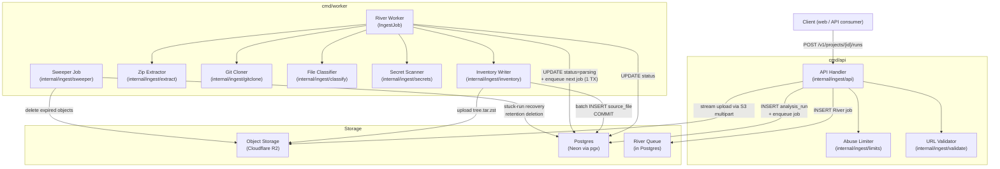
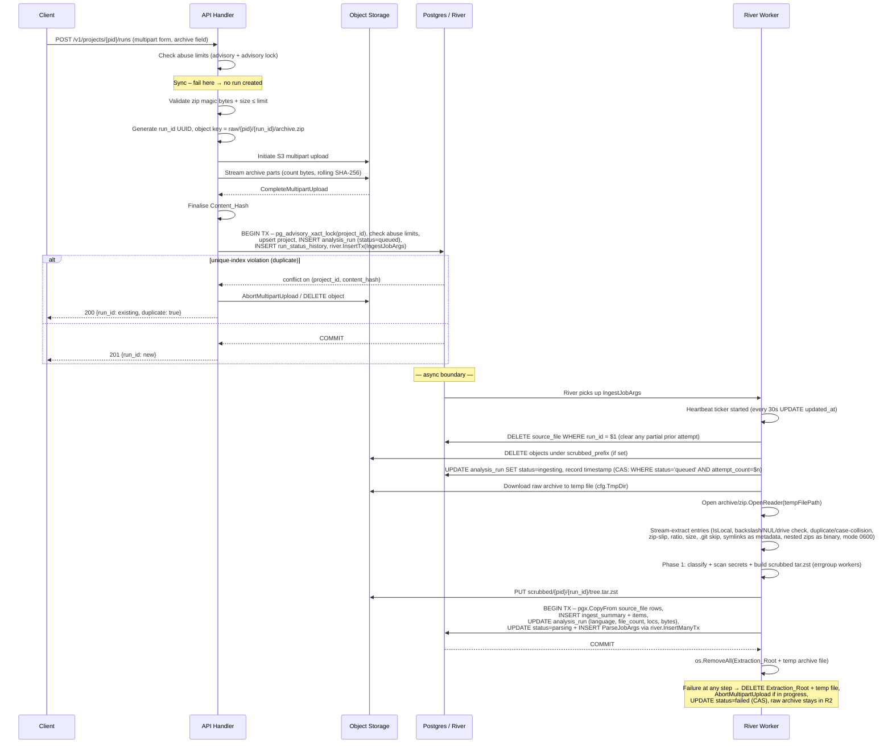

# Design Document

## Overview

Ingest is the first pipeline stage in Exhume. It accepts a repository submitted as a zip archive or a Git URL, validates and stores it, inventories every file with classification and line counts, scrubs secrets into a Scrubbed_Copy (stored as a single compressed `tree.tar.zst` archive), and creates an Analysis_Run. It enqueues the next pipeline job (Parsing) and returns a run_id to the caller.

**Out of scope:** authentication and authorisation, Tree-sitter parsing, graph building, LLM calls, the evidence-linking pipeline, the MCP server, and the web UI.

### Key Design Decisions

| # | Decision | Rationale |
| --- | ---------- | ----------- |
| a | Two-phase validation (sync handler → async worker) | Synchronous checks return errors immediately without wasting background capacity; expensive work (clone, extraction) runs in the worker where failures become run-state, not HTTP errors. |
| b | Streaming upload with on-the-fly SHA-256 (never fully buffered) | Avoids holding 100 MB in memory; Content_Hash is available the moment the last byte is written. |
| c | Partial unique index on `(project_id, content_hash) WHERE status != 'failed'` | Allows exactly-one non-failed run per content+project pair while permitting a new run after failure without dropping the old row. |
| d | Synchronous `git ls-remote` to resolve Commit_SHA before the run is created | Content_Hash is computed before the Analysis_Run exists, so the deduplication check and run creation happen in one transaction with no async ambiguity. |
| e | Git CLI + localhost HTTP CONNECT proxy for IP pinning | Avoids reimplementing the git protocol; the proxy intercepts every TCP connection attempt, validates the destination IP, and lets libcurl handle TLS/SNI naturally. |
| f | Scrubbed_Copy stored as a single `tree.tar.zst` object | A 5,000-file repo with per-file R2 objects requires up to 5,000 PUTs. With a 32-worker upload pool and 50 ms average PUT latency that is ~7.8 seconds just for uploads. A single tar.zst PUT after scanning adds roughly 1–2 s for compression + 1 PUT. Downstream stages extract on demand. |
| g | Sweeper implemented as a periodic River job | River already manages job deduplication across replicas; no additional infrastructure needed for stuck-run recovery or retention deletion. |
| h | `errgroup` + bounded worker pool for parallel file processing | Bounded concurrency prevents goroutine explosion on large repos; `errgroup` propagates the first error and cancels siblings cleanly. |
| i | POST endpoint always accepts `multipart/form-data` | Git submissions use `multipart/form-data` with `git_url` as a text field so that supplementary files can be streamed alongside Git submissions without a separate upload step. |
| j | Zip uploads use S3 multipart upload | On any failure (stream abort, 413, unique-index violation) the multipart upload is explicitly aborted via `AbortMultipartUpload` to avoid leaving incomplete parts. |

---

## Architecture

### Component Diagram



### Package Layout

| Package | Responsibility |
| --------- | --------------- |
| `internal/ingest/api` | HTTP handler, multipart parsing, sync-validation orchestration, response serialisation |
| `internal/ingest/limits` | Per-project and global concurrency count checks (abuse limiter) |
| `internal/ingest/validate` | URL scheme/userinfo check, DNS resolution, IP-range blocked-list, zip magic-byte validation |
| `internal/ingest/extract` | Streaming zip extractor: zip-slip protection, compression-ratio and size limits, symlink and nested-archive handling |
| `internal/ingest/gitclone` | `git ls-remote` wrapper, localhost proxy builder, IP-pinned shallow clone, redirect interceptor, working-tree walker |
| `internal/ingest/classify` | Priority-ordered file classifier and language/framework detector |
| `internal/ingest/secrets` | Best-effort secret scanner, line-preserving replacement, Ingest_Summary builder |
| `internal/ingest/inventory` | Batched Source_File insert, scrubbed tar.zst build and upload, errgroup worker pool |
| `internal/ingest/jobs` | River job arg structs, enqueue helpers, job kind constants |
| `internal/ingest/sweeper` | Periodic River job for stuck-run recovery and retention-period object deletion |
| `internal/ingest/storage` | Object_Storage client wrapper (R2/S3 SDK, put/get/delete/list-prefix, multipart upload) |
| `cmd/migrate` | Standalone binary that applies goose migrations against the Neon direct connection URL |

---

## 3. Two-Phase Flow

### Zip Submission



### Git Submission

```mermaid
sequenceDiagram
    participant C as Client
    participant H as API Handler
    participant Proxy as Localhost Proxy
    participant DB as Postgres / River

    C->>H: POST /v1/projects/{pid}/runs (multipart form: git_url, ref fields first)
    H->>H: Check abuse limits
    Note over H: Sync – fail here → no run created
    H->>H: Validate URL (scheme, userinfo, DNS, IP-range check)
    H->>H: Validate ref regex ^[A-Za-z0-9._/-]{1,200}$ and no leading '-'
    H->>Proxy: Start per-request localhost proxy (validates dest IP, CONNECT port=443 only)
    H->>Proxy: git ls-remote -- <sanitized_url> <ref|HEAD> (10s timeout, via proxy)
    Note over Proxy: Ref resolution: prefer refs/heads over refs/tags;<br/>annotated tags use peeled ^{} line
    Proxy-->>H: Commit_SHA resolved
    H->>H: Compute Content_Hash (SHA-256 of commit_sha || sanitized_url, length-prefixed)
    H->>R2: Stream supplementary files (schema_dump, docs[]) to run_artifact rows
    H->>DB: BEGIN TX – pg_advisory_xact_lock(project_id), check abuse limits,<br/>upsert project, INSERT analysis_run (status=queued),<br/>INSERT run_status_history, river.InsertTx(IngestJobArgs)
    alt duplicate
        DB-->>H: conflict
        H-->>C: 200 {run_id: existing, duplicate: true}
    else
        DB-->>H: COMMIT
        H-->>C: 201 {run_id: new}
    end

    Note over DB: — async boundary —

    DB->>W: River picks up IngestJobArgs
    participant W as River Worker
    W->>W: Heartbeat ticker started (every 30s UPDATE updated_at)
    W->>DB: DELETE source_file WHERE run_id = $1 (clear partial prior attempt)
    W->>DB: UPDATE analysis_run SET status=ingesting (CAS: WHERE status='queued' AND attempt_count=$n)
    W->>W: Re-resolve hostname, validate all IPs, pick validated IP
    W->>Proxy: Start worker-side proxy (pinned to validated IP, CONNECT port=443 only,<br/>byte counter on server→client tunnel)
    W->>Proxy: git fetch --depth=1 origin <commit_sha> via proxy (byte limit enforced in tunnel)
    Note over W: Fallback: fetch by ref then verify SHA if SHA-fetch rejected
    W->>W: git checkout <commit_sha>
    W->>W: filepath.WalkDir: verify no symlinks, skip .git/, apply IsLocal + safety checks
    W->>W: Phase 1: classify + scan secrets + build scrubbed tar.zst (errgroup workers)
    W->>R2: PUT scrubbed/{pid}/{run_id}/tree.tar.zst
    participant R2 as Object Storage
    W->>DB: BEGIN TX – pgx.CopyFrom source_file, INSERT ingest_summary,<br/>UPDATE analysis_run (language, file_count, locs, bytes, status=parsing),<br/>INSERT ParseJobArgs via river.InsertManyTx
    DB-->>W: COMMIT
    W->>W: os.RemoveAll(clone_dir)
    Note over W: Failure → DELETE clone_dir, UPDATE status=failed (CAS)
```

---

## 4. API

### Endpoints

#### POST /v1/projects/{project_id}/runs

Submit a repository. `project_id` may be a known UUID or the literal `new` to auto-generate one.

The endpoint **always** accepts `Content-Type: multipart/form-data`. The `git_url` and `ref` fields must appear as form fields **before** any file parts so the handler can begin validation before reading file bodies. Supplementary files are streamed to R2 after `git_url` validation passes.

**Zip upload** — `Content-Type: multipart/form-data`

| Field | Type | Required | Notes |
| ------- | ------ | ---------- | ------- |
| `archive` | file | yes | zip file, ≤ INGEST_MAX_UPLOAD_BYTES |
| `schema_dump` | file | no | supplementary schema file |
| `docs[]` | file[] | no | supplementary documentation files |

**Git URL** — `Content-Type: multipart/form-data`

| Field | Type | Required | Notes |
| ------- | ------ | ---------- | ------- |
| `git_url` | text | yes | HTTPS URL; must appear before file parts |
| `ref` | text | no | branch, tag, or HEAD; must appear before file parts; validated with `^[A-Za-z0-9._/-]{1,200}$`, leading `-` rejected |
| `schema_dump` | file | no | supplementary schema file |
| `docs[]` | file[] | no | supplementary documentation files |

**Response 201 — new run created**

```json
{
  "run_id": "018f1a2b-...",
  "project_id": "018f1a2b-...",
  "status": "queued",
  "duplicate": false,
  "created_at": "2026-11-03T10:00:00Z"
}
```

**Response 200 — duplicate detected**

```json
{
  "run_id": "018e9c1d-...",
  "project_id": "018f1a2b-...",
  "status": "ingesting",
  "duplicate": true,
  "created_at": "2026-11-03T09:58:00Z"
}
```

#### GET /v1/projects/{project_id}/runs/{run_id}

**Response 200**

```json
{
  "run_id": "018f1a2b-...",
  "project_id": "018f1a2b-...",
  "status": "parsing",
  "source_type": "zip",
  "sanitized_url": null,
  "commit_sha": null,
  "failure_reason": null,
  "attempt_count": 0,
  "created_at": "2026-11-03T10:00:00Z",
  "updated_at": "2026-11-03T10:00:31Z"
}
```

#### GET /v1/projects/{project_id}/runs/{run_id}/ingest-summary

**Response 200**

```json
{
  "run_id": "018f1a2b-...",
  "total_masked_count": 4,
  "files_scanned": 42,
  "files_redacted_whole": 1,
  "items": [
    { "secret_type": "API_KEY", "count": 2 },
    { "secret_type": "PASSWORD", "count": 1 },
    { "secret_type": "JWT", "count": 1 }
  ]
}
```

The endpoint never returns secret values, file content, or file paths.

### Error Code Table

| Error Code | HTTP Status | Retryable | Requirement(s) |
| ------------ | ------------- | ----------- | ---------------- |
| `INVALID_SCHEME` | 400 | no | R4.1 |
| `EMBEDDED_CREDENTIALS` | 400 | no | R4.2 |
| `DNS_RESOLUTION_FAILED` | 400 | no | R4.3 |
| `DISALLOWED_ADDRESS` | 400 | no | R4.4 |
| `INVALID_REF` | 400 | no | R1.2, R3 |
| `GIT_LS_REMOTE_FAILED` | 400 | no | R1.4, R4.1–4.4 |
| `INVALID_ZIP` | 400 | no | R3.1 |
| `UPLOAD_TOO_LARGE` | 413 | no | R2.1 |
| `STORAGE_FAILURE` | 502 | yes | R1.5 |
| `PROJECT_CREATION_FAILED` | 500 | no | R10.5 |
| `ABUSE_LIMIT_PER_PROJECT` | 429 | yes | R11.1 |
| `ABUSE_LIMIT_GLOBAL` | 429 | yes | R11.2 |
| `NOT_FOUND` | 404 | no | — |
| `INTERNAL` | 500 | no | — |

Error response body:

```json
{
  "error": {
    "code": "UPLOAD_TOO_LARGE",
    "message": "archive size 157286400 exceeds limit 104857600",
    "retryable": false
  }
}
```

### OpenAPI Fragment

```yaml
# Append to api/openapi.yaml

paths:
  /v1/projects/{project_id}/runs:
    post:
      operationId: submitRun
      summary: Submit a repository for analysis
      parameters:
        - name: project_id
          in: path
          required: true
          schema:
            type: string
      requestBody:
        content:
          multipart/form-data:
            schema:
              type: object
              properties:
                archive:
                  type: string
                  format: binary
                  description: "Zip archive (zip submissions only)"
                git_url:
                  type: string
                  description: "HTTPS Git URL (Git submissions only); must appear before file parts"
                ref:
                  type: string
                  description: "Branch, tag, or HEAD (Git submissions only); must appear before file parts"
                schema_dump:
                  type: string
                  format: binary
                docs:
                  type: array
                  items:
                    type: string
                    format: binary
      responses:
        '201':
          $ref: '#/components/responses/RunCreated'
        '200':
          $ref: '#/components/responses/RunDuplicate'
        '400':
          $ref: '#/components/responses/ValidationError'
        '413':
          $ref: '#/components/responses/PayloadTooLarge'
        '429':
          $ref: '#/components/responses/RateLimited'
        '500':
          $ref: '#/components/responses/InternalError'
        '502':
          $ref: '#/components/responses/StorageError'

  /v1/projects/{project_id}/runs/{run_id}:
    get:
      operationId: getRun
      summary: Get analysis run status
      parameters:
        - name: project_id
          in: path
          required: true
          schema: { type: string }
        - name: run_id
          in: path
          required: true
          schema: { type: string }
      responses:
        '200':
          $ref: '#/components/responses/RunStatus'
        '404':
          $ref: '#/components/responses/NotFound'

  /v1/projects/{project_id}/runs/{run_id}/ingest-summary:
    get:
      operationId: getIngestSummary
      summary: Get secret masking summary for a run
      parameters:
        - name: project_id
          in: path
          required: true
          schema: { type: string }
        - name: run_id
          in: path
          required: true
          schema: { type: string }
      responses:
        '200':
          $ref: '#/components/responses/IngestSummary'
        '404':
          $ref: '#/components/responses/NotFound'

components:
  schemas:
    RunResponse:
      type: object
      properties:
        run_id: { type: string, format: uuid }
        project_id: { type: string, format: uuid }
        status: { type: string, enum: [queued, ingesting, parsing, failed] }
        source_type: { type: string, enum: [zip, git] }
        sanitized_url: { type: string, nullable: true }
        commit_sha: { type: string, nullable: true }
        failure_reason: { type: string, nullable: true }
        attempt_count: { type: integer }
        duplicate: { type: boolean }
        created_at: { type: string, format: date-time }
        updated_at: { type: string, format: date-time }

    IngestSummaryResponse:
      type: object
      properties:
        run_id: { type: string, format: uuid }
        total_masked_count: { type: integer }
        files_scanned: { type: integer }
        files_redacted_whole: { type: integer }
        items:
          type: array
          items:
            type: object
            properties:
              secret_type:
                type: string
                enum: [API_KEY, PASSWORD, TOKEN, PRIVATE_KEY, CONNECTION_STRING, JWT]
              count: { type: integer }

    ErrorResponse:
      type: object
      properties:
        error:
          type: object
          properties:
            code: { type: string }
            message: { type: string }
            retryable: { type: boolean }

  responses:
    RunCreated:
      description: Run created successfully
      content:
        application/json:
          schema: { $ref: '#/components/schemas/RunResponse' }
    RunDuplicate:
      description: Identical submission already exists
      content:
        application/json:
          schema: { $ref: '#/components/schemas/RunResponse' }
    RunStatus:
      description: Run status
      content:
        application/json:
          schema: { $ref: '#/components/schemas/RunResponse' }
    IngestSummary:
      description: Ingest summary
      content:
        application/json:
          schema: { $ref: '#/components/schemas/IngestSummaryResponse' }
    ValidationError:
      description: Request validation failed
      content:
        application/json:
          schema: { $ref: '#/components/schemas/ErrorResponse' }
    PayloadTooLarge:
      description: Upload exceeds size limit
      content:
        application/json:
          schema: { $ref: '#/components/schemas/ErrorResponse' }
    RateLimited:
      description: Concurrency limit reached (retryable)
      content:
        application/json:
          schema: { $ref: '#/components/schemas/ErrorResponse' }
    StorageError:
      description: Object storage unavailable
      content:
        application/json:
          schema: { $ref: '#/components/schemas/ErrorResponse' }
    NotFound:
      description: Resource not found
      content:
        application/json:
          schema: { $ref: '#/components/schemas/ErrorResponse' }
    InternalError:
      description: Internal server error
      content:
        application/json:
          schema: { $ref: '#/components/schemas/ErrorResponse' }
```

---

## Data Models

### Tables

#### `project`

```
id          UUID         PRIMARY KEY DEFAULT gen_random_uuid()
created_at  TIMESTAMPTZ  NOT NULL DEFAULT now()
```

#### `analysis_run`

```
id                   UUID         PRIMARY KEY DEFAULT gen_random_uuid()
project_id           UUID         NOT NULL REFERENCES project(id)
status               TEXT         NOT NULL   -- 'queued' | 'ingesting' | 'parsing' | 'failed'
source_type          TEXT         NOT NULL   -- 'zip' | 'git'
sanitized_url        TEXT                    -- null for zip
commit_sha           TEXT                    -- null for zip
source_ref           TEXT                    -- branch/tag/HEAD used in ls-remote; null for zip
content_hash         TEXT         NOT NULL   -- hex-encoded SHA-256
failure_reason       TEXT                    -- max 1000 chars; null unless status='failed'
attempt_count        INT          NOT NULL DEFAULT 0
scrubbed_object_key  TEXT                    -- R2 object key of scrubbed tree.tar.zst; null until ingesting completes
primary_language     TEXT                    -- null until ingesting completes
secondary_languages  JSONB        NOT NULL DEFAULT '[]'
frameworks           JSONB        NOT NULL DEFAULT '[]'
file_count           INT          NOT NULL DEFAULT 0
total_loc            INT          NOT NULL DEFAULT 0
total_bytes          BIGINT       NOT NULL DEFAULT 0
created_at           TIMESTAMPTZ  NOT NULL DEFAULT now()
updated_at           TIMESTAMPTZ  NOT NULL DEFAULT now()

CONSTRAINT analysis_run_status_check CHECK (status IN ('queued','ingesting','parsing','failed'))
```

**Indexes:**

```sql
-- Deduplication: one non-failed run per project+content
CREATE UNIQUE INDEX analysis_run_dedup
  ON analysis_run(project_id, content_hash)
  WHERE status != 'failed';

-- Abuse-limit count queries
CREATE INDEX analysis_run_project_status
  ON analysis_run(project_id, status);

-- Sweeper queries (stuck runs, retention)
CREATE INDEX analysis_run_status_updated
  ON analysis_run(status, updated_at);
```

Status values use lowercase strings (not a Postgres ENUM) so that adding new states requires only a migration comment, not an ALTER TYPE.

#### `run_artifact`

Replaces the former `raw_object_key` column. All raw artifact references go through this table.

```sql
CREATE TABLE run_artifact (
    id                 BIGSERIAL    PRIMARY KEY,
    run_id             UUID         NOT NULL REFERENCES analysis_run(id),
    project_id         UUID         NOT NULL REFERENCES project(id),
    artifact_type      TEXT         NOT NULL,  -- 'raw_archive' | 'supplementary'
    object_key         TEXT         NOT NULL,
    sanitized_filename TEXT         NOT NULL,  -- basename only, no paths
    size_bytes         BIGINT       NOT NULL DEFAULT 0,
    created_at         TIMESTAMPTZ  NOT NULL DEFAULT now()
);
CREATE INDEX run_artifact_run ON run_artifact(run_id);
```

#### `run_status_history`

```
id           BIGSERIAL    PRIMARY KEY
run_id       UUID         NOT NULL REFERENCES analysis_run(id)
status       TEXT         NOT NULL
reason       TEXT                    -- null unless Failed or cancellation
recorded_at  TIMESTAMPTZ  NOT NULL DEFAULT now()
```

Index: `(run_id)` for timeline queries.

#### `source_file`

```
id              BIGSERIAL    PRIMARY KEY
run_id          UUID         NOT NULL REFERENCES analysis_run(id)
project_id      UUID         NOT NULL REFERENCES project(id)  -- denormalised for scoped queries
path            TEXT         NOT NULL   -- relative to repo root
classification  TEXT         NOT NULL   -- one of the FileClassification values
symlink_target  TEXT                    -- null unless the entry is a symlink
size_bytes      BIGINT       NOT NULL
line_count      INT          NOT NULL   -- non-blank lines; 0 for binary
created_at      TIMESTAMPTZ  NOT NULL DEFAULT now()

CONSTRAINT source_file_run_path_unique UNIQUE (run_id, path)
```

**Indexes:**

```sql
CREATE INDEX source_file_run ON source_file(run_id);
CREATE INDEX source_file_project_run ON source_file(project_id, run_id);
```

The `project_id` column is denormalised here so that every sqlc query can include `AND project_id = $1` without a join, ensuring cross-project isolation at the query level.

#### `ingest_summary`

```
id                   UUID         PRIMARY KEY DEFAULT gen_random_uuid()
run_id               UUID         NOT NULL UNIQUE REFERENCES analysis_run(id)
project_id           UUID         NOT NULL REFERENCES project(id)
total_masked_count   INT          NOT NULL DEFAULT 0
files_scanned        INT          NOT NULL DEFAULT 0
files_redacted_whole INT          NOT NULL DEFAULT 0
created_at           TIMESTAMPTZ  NOT NULL DEFAULT now()
```

#### `ingest_summary_item`

```
id          BIGSERIAL  PRIMARY KEY
summary_id  UUID       NOT NULL REFERENCES ingest_summary(id)
secret_type TEXT       NOT NULL  -- 'API_KEY' | 'PASSWORD' | 'TOKEN' | 'PRIVATE_KEY' | 'CONNECTION_STRING' | 'JWT'
count       INT        NOT NULL
```

Index: `(summary_id)` for summary reads.

### sqlc Query Scoping Pattern

Every query that touches `analysis_run`, `source_file`, or `ingest_summary` carries `project_id` as an explicit parameter in the WHERE clause. Example:

```sql
-- name: GetRun :one
SELECT * FROM analysis_run
WHERE id = $1 AND project_id = $2;

-- name: ListSourceFiles :many
SELECT * FROM source_file
WHERE run_id = $1 AND project_id = $2;
```

Queries generated by sqlc live in `db/queries/ingest.sql`; the generated Go code is imported by `internal/ingest/`.

### Goose Migration Outline

```
db/migrations/
  00001_create_project.sql              -- CREATE TABLE project
  00002_create_analysis_run.sql         -- CREATE TABLE analysis_run, indexes
  00003_create_run_status_history.sql   -- CREATE TABLE run_status_history, index
  00004_create_source_file.sql          -- CREATE TABLE source_file, indexes
  00005_create_ingest_summary.sql       -- CREATE TABLE ingest_summary, ingest_summary_item, indexes
  00006_create_run_artifact.sql         -- CREATE TABLE run_artifact, index
```

Each migration file has a `-- +goose Up` and `-- +goose Down` section. Migrations are applied by running `cmd/migrate` (a separate binary at `apps/server/cmd/migrate/main.go`) against the Neon direct connection URL. **Neither `cmd/api` nor `cmd/worker` run migrations at startup.** This prevents race conditions in multi-replica deployments and keeps startup fast.

---

## 6. State Machine

```mermaid
stateDiagram-v2
    [*] --> queued : Submission passes sync validation;\nAnalysis_Run created;\nIngestJobArgs enqueued

    queued --> ingesting : Worker picks up job;\nCAS: WHERE status='queued' AND attempt_count=$n;\nrecord transition timestamp in run_status_history;\nheartbeat ticker started

    ingesting --> parsing : Async work complete;\nATOMIC TX: UPDATE status=parsing (CAS) +\nINSERT ParseJobArgs via river.InsertManyTx;\nrecord transition timestamp

    ingesting --> failed : Async step error OR context cancellation;\nCAS transition;\nrecord failure_reason (≤1000 chars,\nno content/secrets);\nrecord transition timestamp;\nemit ingest.failed event

    ingesting --> queued : SWEEPER: stuck_run_timeout exceeded\n(no heartbeat) AND attempt_count < max_attempt_count;\nSELECT FOR UPDATE SKIP LOCKED;\nCAS transition;\nINCREMENT attempt_count;\nre-enqueue IngestJobArgs with Attempt=attempt_count+1\n(same run_id — NOT a new run)

    queued --> failed : SWEEPER: stuck_queued_timeout exceeded\nAND attempt_count >= max_attempt_count;\nrecord stuck-run reason

    failed --> [*] : attempt_count >= max_attempt_count\nOR normal failure (no auto-retry);\nraw archive retained until retention period

    note right of failed
      User resubmission after failure (R8.4):
      A NEW Analysis_Run is created with a
      new run_id. The partial index allows this
      because the existing row has status='failed'.
      This is distinct from sweeper retry above.
    end note

    note right of ingesting
      Heartbeat keeps updated_at fresh every 30s.
      Context cancellation -> Failed within 5s (CAS).
      Sweeper retry -> back to queued (same run_id).
      Max attempts reached -> Failed (stuck-run reason).
    end note
```

**Persisted on each transition:**

| Transition | What is persisted |
| ------------ | ------------------- |
| `[*] → queued` | `analysis_run` row inserted; `run_status_history` row with status=queued |
| `queued → ingesting` | `analysis_run.status` updated (CAS); `analysis_run.updated_at`; `run_status_history` row |
| `ingesting → parsing` | `analysis_run.status` (CAS); `analysis_run.updated_at`; `run_status_history` row; `source_file` rows; `ingest_summary` + items; `analysis_run.primary_language`, `secondary_languages`, `frameworks`, `file_count`, `total_loc`, `total_bytes`; next River job — all in one TX |
| `ingesting → failed` | `analysis_run.status` (CAS); `analysis_run.failure_reason`; `analysis_run.updated_at`; `run_status_history` row with reason |
| `ingesting → queued` (sweeper retry) | `analysis_run.status` (CAS); `analysis_run.attempt_count` incremented; `analysis_run.updated_at`; `run_status_history` row with reason="stuck-run retry N" |

**CAS semantics:** every `UPDATE analysis_run SET status = $new` carries `WHERE id = $1 AND status = $old AND attempt_count = $current`. If 0 rows are updated, the worker logs a conflict and returns without error (idempotent). This prevents a sweeper transition from overwriting a worker that legitimately completed.

---

## 7. Worker Job Design

### IngestJob Args

```go
// internal/ingest/jobs/args.go

type IngestJobArgs struct {
    RunID     uuid.UUID `json:"run_id"`
    ProjectID uuid.UUID `json:"project_id"`
    SourceType string   `json:"source_type"` // "zip" | "git"
    Attempt   int       `json:"attempt"`     // incremented by sweeper on each retry
}

func (IngestJobArgs) Kind() string { return "ingest" }

func (IngestJobArgs) InsertOpts() river.InsertOpts {
    return river.InsertOpts{
        // Uniqueness on (RunID, Attempt): each sweeper-initiated retry is a distinct job.
        // The API handler always enqueues Attempt=0.
        UniqueOpts: river.UniqueOpts{ByArgs: true},
    }
}
```

Because uniqueness is `ByArgs: true` on all fields including `Attempt`, two concurrent calls to enqueue `IngestJobArgs{RunID: x, Attempt: 0}` are deduplicated by River. A sweeper-initiated retry enqueues `Attempt: run.attempt_count + 1`, which is a different set of args and thus a new distinct job.

### ParseJobArgs Stub

```go
// internal/ingest/jobs/parse_args.go
// ParseJobArgs is a stub; the full definition lives in internal/parse/jobs.
type ParseJobArgs struct {
    RunID     uuid.UUID `json:"run_id"`
    ProjectID uuid.UUID `json:"project_id"`
}

func (ParseJobArgs) Kind() string { return "parse" }
```

### Retry and Backoff Policy

**River-level retries (transient infrastructure failures):**
- Max attempts: 3 (River-level retries for transient infrastructure failures, e.g., R2 write fails, DB temporarily unavailable).
- Backoff: exponential starting at 30 s (30 s, 60 s, 120 s).
- The run **stays in `ingesting`** during River retries. The heartbeat goroutine keeps `updated_at` fresh, so the sweeper will not misidentify the run as stuck.
- On River final failure: the job's error handler transitions `analysis_run` to `failed` and records the reason.

**Sweeper retries (stuck/silent runs):**
- Handle runs that started but went silent (no heartbeat update within `INGEST_STUCK_RUN_TIMEOUT_SECS`).
- The sweeper transitions the run back to `queued` with `attempt_count + 1` and enqueues a new `IngestJobArgs` with `Attempt = attempt_count + 1`.
- These do not overlap with River retries because: (a) the heartbeat keeps `updated_at` fresh while a River-retried job is active; (b) the compare-and-set prevents a sweeper transition if the run is no longer in `ingesting` at the expected `attempt_count`.

### Heartbeat

The worker goroutine spawns a background ticker at the start of `Work()`:

```go
go func() {
    ticker := time.NewTicker(cfg.HeartbeatInterval)
    defer ticker.Stop()
    for {
        select {
        case <-ticker.C:
            _, _ = db.Exec(ctx,
                "UPDATE analysis_run SET updated_at = now() WHERE id = $1 AND status = 'ingesting'",
                job.Args.RunID)
        case <-ctx.Done():
            return
        }
    }
}()
```

The heartbeat goroutine exits when the job context is cancelled.

### Cancellation Handling

```go
func (w *IngestWorker) Work(ctx context.Context, job *river.Job[IngestJobArgs]) error {
    defer func() {
        os.RemoveAll(extractionRoot) // always clean up temp dir
    }()

    // Clear any partial output from prior attempts before starting.
    w.clearPartialOutput(context.Background(), job.Args.RunID, job.Args.ProjectID)

    // Start heartbeat
    go w.heartbeat(ctx, job.Args.RunID)

    // CAS transition to ingesting
    updated, err := w.casTransition(ctx, job.Args.RunID, "queued", "ingesting", job.Args.Attempt)
    if err != nil || !updated {
        return nil // another worker already transitioned; idempotent exit
    }

    // ... processing ...

    if ctx.Err() != nil {
        return w.failRun(context.Background(), job.Args.RunID, job.Args.Attempt, "cancelled: "+ctx.Err().Error())
    }
    return nil
}
```

The `context.Background()` passed to `failRun` ensures the status update completes even after the job context is cancelled. All file-processing goroutines receive the job context via `errgroup`; cancellation propagates within 2 seconds (R9.4).

### Partial Output Clearing

At the start of `Work()`, before doing anything else, the worker:
1. Deletes `source_file WHERE run_id = $1` (removes partial rows from a prior attempt).
2. If `analysis_run.scrubbed_object_key` is set, deletes the object from R2.
3. Clears `analysis_run.scrubbed_object_key = NULL`.

This ensures every attempt starts from a clean extraction state regardless of how the previous attempt ended.

### Atomic Ingesting→Parsing Transition

```go
// Pseudocode — internal/ingest/jobs/transition.go
func TransitionToParsing(ctx context.Context, pool *pgxpool.Pool, riverClient *river.Client,
                          runID uuid.UUID, attempt int, nextJobArgs ParseJobArgs,
                          summary IngestSummary, stats RunStats) error {
    tx, _ := pool.Begin(ctx)
    defer tx.Rollback(ctx)
    // 1. UPDATE analysis_run SET status='parsing', primary_language=..., file_count=...,
    //       total_loc=..., total_bytes=..., updated_at=now()
    //    WHERE id=runID AND status='ingesting' AND attempt_count=attempt
    // 2. INSERT INTO run_status_history ...
    // 3. Batch INSERT source_file rows via pgx.CopyFrom
    // 4. INSERT ingest_summary + ingest_summary_item rows
    // 5. riverClient.InsertManyTx(tx, []river.InsertManyParams{{Args: nextJobArgs}})
    return tx.Commit(ctx)
}
```

**Note:** `river.InsertTx` and `river.InsertManyTx` are methods on `*river.Client` and require the client to be initialised with the same `pgxpool.Pool`. The above pseudocode is indicative; verify method signatures against the installed version of `github.com/riverqueue/river`. The `riverClient` must be passed into `TransitionToParsing` as a parameter.

`river.InsertManyTx` writes the next job into the River jobs table within the same Postgres transaction. If the transaction is rolled back, neither the status update nor the job insertion persists (R7.3).

---

## Components and Interfaces

### 8a. Zip Extractor

```go
// internal/ingest/extract/extractor.go

type LimitConfig struct {
    MaxUploadBytes      int64
    MaxExtractedBytes   int64
    MaxFileCount        int
    MaxSingleFileBytes  int64
    MaxCompressionRatio float64
    TmpDir              string
}

type ExtractedFile struct {
    RelPath        string
    Classification string  // set later by classifier; blank here
    SizeBytes      int64
    SymlinkTarget  string  // non-empty only for symlinks
    IsBinary       bool    // set if detected as nested zip or binary magic
}

type ExtractResult struct {
    Files      []ExtractedFile
    TotalBytes int64
}

type Extractor interface {
    // archivePath is a local temp file path; the caller downloads from R2 first.
    Extract(ctx context.Context, archivePath string, root string, cfg LimitConfig) (ExtractResult, error)
}
```

**Pre-extraction: download to temp file**

The caller (the River worker) downloads the raw archive from R2 to a temp file using `os.CreateTemp(cfg.TmpDir, "ingest-archive-*")` before calling `Extract`. The extractor then opens the local file with `archive/zip.OpenReader(archivePath)`. This avoids streaming a ranged GET while simultaneously processing entries; the temp file is removed in the worker's deferred cleanup.

**Algorithm:**

1. Open `archive/zip.OpenReader(archivePath)` — reads the central directory from the local temp file.
2. Check `len(r.File) > cfg.MaxFileCount` immediately — fail fast.
3. Initialise a `seen := map[string]struct{}{}` for duplicate/case-collision detection.
4. For each `*zip.File` entry in central-directory order:
   - Skip if `f.Name == ".git"` or `strings.HasPrefix(f.Name, ".git/")`.
   - **Safety checks on the name** (any failure → abort + delete):
     - `!filepath.IsLocal(f.Name)` — reject (catches `..`, absolute paths, rooted paths).
     - `strings.ContainsAny(f.Name, "\\\x00")` — reject (backslash, NUL byte).
     - Matches `[A-Za-z]:` at position 0 (Windows drive letter) — reject.
     - `lower := strings.ToLower(f.Name)`; if `lower` is already in `seen` — reject (duplicate or case-collision). Otherwise `seen[lower] = struct{}{}`.
   - If `f.Mode()&os.ModeSymlink != 0`: record `f.Name` + link target as metadata; do **not** extract. Continue.
   - Check declared size: `f.UncompressedSize64 > cfg.MaxSingleFileBytes` → abort.
   - If `f.CompressedSize64 >= 1024` and `f.UncompressedSize64/f.CompressedSize64 > cfg.MaxCompressionRatio` → abort (zip-bomb ratio).
   - Compute destination path: `dest := filepath.Join(root, f.Name)`. (At this point `filepath.IsLocal` already guarantees no traversal; the `filepath.Join` is for constructing the OS path.)
   - Open `rc, _ := f.Open()`.
   - Peek first 4 bytes: if `== "PK\x03\x04"` → nested zip; treat as opaque binary (`IsBinary=true`); the entry still passes through `io.LimitReader` and the cumulative size counter before being written to disk.
   - Create destination file with `os.OpenFile(dest, os.O_CREATE|os.O_EXCL|os.O_WRONLY, 0600)` — mode `0600` always; the archive's mode bits are ignored entirely.
   - Wrap: `lr := io.LimitReader(rc, cfg.MaxSingleFileBytes+1)`.
   - `n, err := io.Copy(dst, lr)` — count actual bytes written.
   - If `n > cfg.MaxSingleFileBytes` or `n > f.UncompressedSize64` → abort.
   - Accumulate `totalBytes += n`; if `totalBytes > cfg.MaxExtractedBytes` → abort.
5. **On any abort:** `os.RemoveAll(root)`, return typed error with constraint name + entry name (no content, no paths in error message beyond entry name).
6. Return `ExtractResult{Files: files, TotalBytes: totalBytes}`.

### 8b-i. Git ls-remote and Cloner

```go
// internal/ingest/gitclone/validator.go

type GitValidator interface {
    // ValidateAndResolve runs synchronously in the API handler.
    // Returns the sanitized URL and resolved commit SHA, or an error with a code.
    ValidateAndResolve(ctx context.Context, rawURL, ref string) (sanitizedURL, commitSHA string, err error)
}

// internal/ingest/gitclone/cloner.go

type CloneConfig struct {
    TimeoutSecs    int
    MaxUploadBytes int64
    TmpDir         string
}

type GitCloner interface {
    // Clone runs in the River worker. Clones the exact commitSHA into destDir
    // and returns the list of extracted files discovered by the working-tree walk.
    Clone(ctx context.Context, sanitizedURL, commitSHA, ref, destDir string, cfg CloneConfig) ([]ExtractedFile, error)
}
```

**Ref validation (API handler):**

Before any git call, validate the `ref` field:
- Must match `^[A-Za-z0-9._/-]{1,200}$`.
- Must not have a leading `-`.
- An empty `ref` is treated as `HEAD`.

**`git ls-remote` invocation (API handler):**

```
env (scrubbed — see 8b-iii):
  GIT_CONFIG_NOSYSTEM=1
  GIT_TERMINAL_PROMPT=0
  GIT_LFS_SKIP_SMUDGE=1
  GIT_ALLOW_PROTOCOL=https
  HOME=/dev/null
  https_proxy=http://127.0.0.1:{proxyPort}

command:
  git ls-remote -- <sanitized_url> <ref|HEAD>

timeout: cfg.LsRemoteTimeoutSecs (default 10s)
```

**Ref resolution order from ls-remote output:**
1. Prefer `refs/heads/<ref>` over `refs/tags/<ref>`.
2. For annotated tags, use the peeled commit (the line with `^{}` suffix in ls-remote output).
3. If both `refs/heads/<ref>` and `refs/tags/<ref>` exist for the same non-default name, return an `AMBIGUOUS_REF` error.
4. Parse stdout: first SHA-1 column of the matching ref line.

**Fallback for SHA-fetch in the worker (Decision 16b):**

1. `git fetch --depth=1 origin <commitSHA>` — works on most hosts.
2. On failure: `git fetch --depth=1 origin <source_ref>` (stored in `analysis_run.source_ref`).
3. `git checkout <commitSHA>`.
4. Verify: `git rev-parse HEAD` == stored `commitSHA`; mismatch → `COMMIT_SHA_MISMATCH` failure.

### 8b-ii. Git Working Tree Walk

After cloning, walk the working tree using `filepath.WalkDir`:

1. **No symlinks on disk:** git is run with `core.symlinks=false` so git writes symlink targets as plain text files rather than creating OS-level symlinks.
2. **Post-clone symlink verification:** run `filepath.WalkDir(destDir, ...)` checking `d.Type()&fs.ModeSymlink != 0`; if any symlink is found, transition the run to Failed with reason `"unexpected symlink in git working tree"`.
3. **Regular files only:** skip entries where `!d.Type().IsRegular()` (directories, device files, named pipes, etc.).
4. **Skip `.git/`:** skip the `.git` directory and all its contents entirely.
5. **Safety checks on each relative path** (same as the zip extractor):
   - `!filepath.IsLocal(relPath)` → abort.
   - `strings.ContainsAny(relPath, "\\\x00")` → abort.
   - Matches Windows drive-letter pattern at position 0 → abort.
   - Duplicate / case-collision check via `map[string]struct{}` keyed on `strings.ToLower(relPath)`.
6. **Size limits:** enforce single-file size limit and cumulative extracted-size limit per entry.
7. **File count limit:** abort if the total file count exceeds `cfg.MaxFileCount`.
8. **Output:** the walk produces `[]ExtractedFile` in the same format as the zip extractor. No new files are created; the walk only reads what git wrote.

`GitCloner.Clone` returns `([]ExtractedFile, error)` so the worker can hand the file list directly to the inventory writer.

### 8b-iii. Git Environment and Proxy

**Exact scrubbed environment for all git invocations (no other env vars inherited):**

```
GIT_CONFIG_NOSYSTEM=1
GIT_TERMINAL_PROMPT=0
GIT_LFS_SKIP_SMUDGE=1
GIT_ALLOW_PROTOCOL=https
HOME=/dev/null
```

**Git config flags passed via `-c`:**

```
credential.helper=
core.hooksPath=/dev/null
core.symlinks=false
core.fsmonitor=false
transfer.fsckObjects=true
protocol.file.allow=never
submodule.recurse=false
http.proxy=http://127.0.0.1:{proxyPort}
```

`NO_PROXY` and `no_proxy` are explicitly unset from the process environment.

**IP pinning via localhost proxy:**

The `gitclone` package starts a per-operation `net/http` server on `127.0.0.1:0` (ephemeral port). It is configured as an HTTP CONNECT proxy. For each CONNECT request:

1. Extract the target `host:port`.
2. **Reject CONNECT to any port other than 443.** Return `403 Forbidden`.
3. Resolve `host` via `net.DefaultResolver.LookupIPAddr`.
4. Validate every resolved IP against the blocked-range list.
5. If any IP is blocked → respond `403 Forbidden`; git/libcurl sees a non-200 CONNECT and aborts.
6. If all valid → pick the first valid IP, open a TCP connection to `validIP:443`.
7. **Byte counting:** the bidirectional pipe tracks total bytes forwarded from server→client. When cumulative bytes exceed `cfg.MaxUploadBytes`, the proxy closes the tunnel (returns TCP RST to git) and sets a flag. The worker detects the flag and transitions the run to Failed with a size-limit-exceeded reason.
8. Respond `200 Connection established`, then pipe bidirectionally.
9. TLS SNI is carried inside the tunnel by libcurl; the proxy never terminates TLS — it only controls which IP the connection reaches. Hostname verification (certificate CN/SAN matching) is handled by libcurl against the original hostname.

**Redirect interception:** the proxy intercepts each CONNECT, so a redirect to a different host causes a new CONNECT request, which is validated again before the connection proceeds.

### 8c. File Classifier

```go
// internal/ingest/classify/classifier.go

type FileClassification string

const (
    ClassBinary       FileClassification = "binary"
    ClassVendor       FileClassification = "vendor"
    ClassGenerated    FileClassification = "generated"
    ClassSQL          FileClassification = "sql"
    ClassBatchScript  FileClassification = "batch_script"
    ClassConfig       FileClassification = "config"
    ClassDocs         FileClassification = "docs"
    ClassSource       FileClassification = "source"
    ClassUnclassified FileClassification = "unclassified"
)

type Classifier interface {
    Classify(relPath string, peekBytes []byte) FileClassification
}
```

**Priority-ordered rule table (first match wins):**

| Priority | Classification | Matching Criteria |
| ---------- | --------------- | ------------------- |
| 1 | `binary` | Extension in: `.exe .dll .so .dylib .bin .obj .o .a .lib .class .jar .war .ear .wasm .pyc .pyd .pyo .ico .png .jpg .jpeg .gif .bmp .webp .svg .mp3 .mp4 .zip .tar .gz .bz2 .xz .7z .rar`; OR first 8 KB contains a null byte (`\x00`) |
| 2 | `vendor` | Any path component is one of: `vendor/ node_modules/ .yarn/ bower_components/ third_party/ extern/ Pods/` |
| 3 | `generated` | Path contains: `_generated` `.generated` `generated/` `.pb.go` `_pb2.py` `.min.js` `.min.css`; OR path component is: `dist/ build/ __pycache__/` |
| 4 | `sql` | Extension in: `.sql .ddl .dml .pls .pks .pkb` |
| 5 | `batch_script` | Extension in: `.sh .bash .zsh .fish .ps1 .psm1 .psd1 .cmd .bat` |
| 6 | `config` | Extension in: `.yaml .yml .toml .ini .cfg .conf .env .json .xml .properties .hcl .tf .tfvars .dockerignore .gitignore .editorconfig .lock`; OR filename (basename) in: `Makefile Dockerfile docker-compose.yml .env.example .env.sample .env.template`; OR pattern `.env.*` (excluding `.env.example .env.sample .env.template` already matched above) |
| 7 | `docs` | Extension in: `.md .mdx .rst .txt .adoc .tex .pdf`; OR any path component is: `docs/ documentation/ wiki/` |
| 8 | `source` | Extension in the explicit source set: `.go .ts .tsx .js .jsx .mjs .cjs .py .pyw .java .cs .rb .rs .php .phtml .inc .kt .kts .swift .cpp .cc .cxx .c++ .hh .hpp .c .h .scala .ex .exs .hs .cbl .cob .cpy .pl .pm .vb .bas .frm .cls .asp .aspx .ascx .ashx .pas .dpr .jsp` |
| — | `unclassified` | Any file whose extension matches none of the above rules |

Note: `.env.example`, `.env.sample`, `.env.template` are classified as `config`, not `binary` or `vendor`, so they pass to the secret scanner normally.

### 8d. Language and Framework Detector

```go
// internal/ingest/classify/detector.go

type DetectionResult struct {
    PrimaryLanguage    *string  // null if none detected
    SecondaryLanguages []string // sorted by line count descending
    Frameworks         []string
}

type Detector interface {
    Detect(files []ExtractedFile, lineCountByPath map[string]int) DetectionResult
}
```

**Language detection** — extension map over source-classified files:

| Extension(s) | Language |
| ------------- | ---------- |
| `.go` | Go |
| `.ts .tsx` | TypeScript |
| `.js .jsx .mjs .cjs` | JavaScript |
| `.py .pyw` | Python |
| `.java` | Java |
| `.cs` | C# |
| `.rb` | Ruby |
| `.rs` | Rust |
| `.php .phtml .inc` | PHP |
| `.kt .kts` | Kotlin |
| `.swift` | Swift |
| `.cpp .cc .cxx .c++ .hh .hpp` | C++ |
| `.c .h` | C |
| `.scala` | Scala |
| `.ex .exs` | Elixir |
| `.hs` | Haskell |
| `.cbl .cob .cpy` | COBOL |
| `.pl .pm` | Perl |
| `.vb .bas .frm .cls` | Visual Basic |
| `.asp` | Classic ASP |
| `.aspx .ascx .ashx` | ASP.NET |
| `.pas .dpr` | Delphi |
| `.jsp` | JSP |
| `.pls .pks .pkb` | PL/SQL |

For each source-classified file: look up extension → add its non-blank line count to the language total. Primary = highest total. Secondary = all others > 0, sorted descending.

**Framework detection** — manifest/build files only (path and filename matching):

| File | Detected Framework(s) |
| ------ | ----------------------- |
| `package.json` | Node; inspect `dependencies` for react, next, vue, angular, express, fastify |
| `go.mod` | Go module; inspect for github.com/riverqueue/river, etc. |
| `requirements.txt` / `pyproject.toml` | Python; inspect for django, flask, fastapi |
| `pom.xml` | Java/Maven |
| `build.gradle` / `build.gradle.kts` | Java/Gradle |
| `Cargo.toml` | Rust |
| `Gemfile` | Ruby; inspect for rails |
| `composer.json` | PHP; inspect for laravel |
| `*.csproj` / `*.sln` | .NET |

### 8e. Secret Scanner

```go
// internal/ingest/secrets/scanner.go

type SecretType string

const (
    TypeAPIKey           SecretType = "API_KEY"
    TypePassword         SecretType = "PASSWORD"
    TypeToken            SecretType = "TOKEN"
    TypePrivateKey       SecretType = "PRIVATE_KEY"
    TypeConnectionString SecretType = "CONNECTION_STRING"
    TypeJWT              SecretType = "JWT"
)

type MaskedItem struct {
    Type  SecretType
    Count int
}

type ScanResult struct {
    ScrubbedContent   []byte       // nil for binary files or whole-file-redacted files
    Items             []MaskedItem
    WholeFileRedacted bool
}

type Scanner interface {
    Scan(relPath string, content []byte, cls FileClassification) ScanResult
}
```

**Pattern table:**

| Type | Detection Approach |
|------|-------------------|
| `API_KEY` | Prefixes: `AKIA`, `ghp_`, `gho_`, `ghs_`, `github_pat_`, `sk-`, `xoxb-`, `xoxp-`, `AIza`; also generic: high-entropy (Shannon entropy > 3.5) string ≥ 20 chars after `=`, `:`, or `"` in an assignment context on a line containing `key`, `api`, `token`, `secret` |
| `PASSWORD` | Regex: `(?i)(password|passwd|pwd)\s*[=:]\s*["']?([^\s"']{4,})` — capture group 2 is the value |
| `TOKEN` | Regex: `(?i)(token|secret|auth_token|access_token|bearer)\s*[=:]\s*["']?([^\s"']{8,})` |
| `PRIVATE_KEY` | Regex: `-----BEGIN\s+(RSA|EC|DSA|OPENSSH|PGP|ENCRYPTED)\s+PRIVATE\s+KEY-----` |
| `CONNECTION_STRING` | Regex: `(jdbc:|mongodb\+srv://|mongodb://|postgresql://|postgres://|mysql://|redis://|amqp://|rediss://)([^\s"']+)` |
| `JWT` | Regex: `eyJ[A-Za-z0-9_-]+\.[A-Za-z0-9_-]+\.[A-Za-z0-9_-]+` (three base64url segments) |

**Line-preserving replacement algorithm:**

1. `lines := bytes.SplitAfter(content, []byte("\n"))` — preserves line endings, including `\r\n`.
2. For each line, apply all patterns in order. For each match, replace **only the captured secret value group** (not the key name, not surrounding quotes) with `[REDACTED:<TYPE>]`.
3. Reassemble: `bytes.Join(lines, nil)`.
4. Output has identical line count and identical byte positions for non-secret characters.

**Secret-bearing filename handling:**

- Match: `filepath.Base(path)` against: `.env`, `.env.*` (glob), `id_rsa`, `*.pem`, `*.key`, `*.pfx`, `*.p12`, `*.jks`.
- **Exceptions** (pass through normal scanning): `.env.example`, `.env.sample`, `.env.template`.
- For matched files: `ScrubbedContent = []byte("[FILE REDACTED: secret-bearing filename]\n")`, `WholeFileRedacted = true`, count as 1 `MaskedItem`.

**Binary file handling:** if `cls == ClassBinary`, return `ScanResult{ScrubbedContent: nil}` immediately. No patterns applied. No Masked_Items added.

**Ingest_Summary construction:**

- Accumulate a `map[SecretType]int` across all files in the run.
- Track `filesScanned` (count of non-binary files processed) and `filesRedactedWhole` (count of whole-file redactions).
- Per-file zero-count records are **not** stored (see proposed R6.8 amendment in section 16).
- Never store: matched values, file paths (only path hashes appear in logs), file content.
- After all files processed: INSERT `ingest_summary` row (with `files_scanned`, `files_redacted_whole`), then INSERT `ingest_summary_item` rows for each type with count > 0.

### 8f. Inventory Writer

```go
// internal/ingest/inventory/writer.go

type WriterConfig struct {
    WorkerCount    int    // default 8, range 1–256
    BatchSize      int    // default 500
    UploadPoolSize int    // default 32
}

type InventoryWriter interface {
    // Write manages its own DB transaction internally via the pool.
    // Phase 1 (outside TX): classify, scan, build scrubbed tar.zst, upload to R2.
    // Phase 2 (one TX): insert source_file, ingest_summary, update analysis_run, enqueue ParseJob.
    Write(ctx context.Context, pool *pgxpool.Pool, riverClient *river.Client,
          runID, projectID uuid.UUID, files []ExtractedFile, extractRoot string,
          cfg WriterConfig, storage storage.Client, scrubbedObjectKey string) (IngestSummary, error)
}
```

**Phase 1 — Outside DB transaction:**

1. Create `errgroup.WithContext(ctx)` with semaphore limiting to `cfg.WorkerCount` goroutines.
2. Fan out `files` to workers. Each worker:
   a. Reads file content from `extractRoot/file.RelPath`.
   b. Classifies (`classify.Classify`).
   c. Counts non-blank lines.
   d. Calls `scanner.Scan(relPath, content, cls)`.
   e. If not binary: adds the scrubbed content to a shared in-memory tar builder.
   f. If binary: adds a metadata-only record (no content) to the tar.
   g. Sends `SourceFileRow` to a buffered collector channel.
3. After all workers finish: compress the collected scrubbed content into a `tar.zst` using `archive/tar` + `github.com/klauspost/compress/zstd`.
4. Upload the `tree.tar.zst` to R2 at `scrubbedObjectKey` in a single PUT. **Await confirmation before proceeding to Phase 2.** On upload failure, abort and return error (the run transitions to Failed).

**Phase 2 — One short DB transaction:**

After all R2 uploads confirm:
1. `pool.Begin(ctx)` — open a single `pgx.Tx`.
2. `pgx.CopyFrom` for all `source_file` rows.
3. INSERT `ingest_summary` + `ingest_summary_item` rows.
4. UPDATE `analysis_run` with `primary_language`, `secondary_languages`, `frameworks`, `file_count`, `total_loc`, `total_bytes`, `scrubbed_object_key`.
5. UPDATE `analysis_run SET status='parsing'`, INSERT next-pipeline River job via `riverClient.InsertManyTx(tx, ...)`.
6. COMMIT once.

**Cancellation:** `errgroup` propagates the first error. The collector drains remaining rows and returns; the caller handles the failure transition.

### 8g. Abuse Limiter

```go
// internal/ingest/limits/limiter.go

var ErrPerProjectLimit = errors.New("per-project concurrency limit reached")
var ErrGlobalLimit = errors.New("global concurrency limit reached")

type LimitConfig struct {
    MaxPerProject int // default 2
    MaxGlobal     int // default 10
}

type LimitChecker interface {
    Check(ctx context.Context, db *pgxpool.Pool, projectID uuid.UUID, cfg LimitConfig) error
}
```

**In-flight upload semaphore:** before starting the R2 streaming upload, the handler acquires a slot from an in-process semaphore (buffered channel of size `INGEST_MAX_RUNS_GLOBAL`). The slot is released on success or failure. This bounds concurrent uploads regardless of the DB count race.

**Database-level serialisation:** inside the run-creation transaction, the handler calls `SELECT pg_advisory_xact_lock(hashtext($project_id::text))` before the abuse-limit COUNT queries and before the INSERT. The advisory lock is automatically released when the transaction commits or rolls back. This makes the check-then-insert atomic per project.

**Algorithm:**

1. Acquire in-flight upload semaphore slot.
2. BEGIN TX → `SELECT pg_advisory_xact_lock(hashtext($project_id::text))`.
3. `SELECT COUNT(*) FROM analysis_run WHERE project_id = $1 AND status IN ('queued', 'ingesting')` — if `>= cfg.MaxPerProject`, release semaphore, return `ErrPerProjectLimit`.
4. `SELECT COUNT(*) FROM analysis_run WHERE status IN ('queued', 'ingesting')` — if `>= cfg.MaxGlobal`, release semaphore, return `ErrGlobalLimit`.
5. Proceed with upsert project + INSERT analysis_run + INSERT River job.
6. COMMIT → release advisory lock. Release semaphore slot on any exit path.

The combination of the in-flight semaphore and the advisory lock makes the per-project check race-safe.

### 8h. Retention and Stuck-Run Sweeper

```go
// internal/ingest/sweeper/sweeper.go

type SweepJobArgs struct{}

func (SweepJobArgs) Kind() string { return "ingest_sweep" }

func (SweepJobArgs) InsertOpts() river.InsertOpts {
    return river.InsertOpts{
        UniqueOpts: river.UniqueOpts{
            ByQueue:  true,
            ByPeriod: 60 * time.Second,
        },
    }
}
```

`cmd/worker` registers `river.NewPeriodicJob(river.PeriodicInterval(cfg.SweepInterval), ...)` at startup.

**`ByQueue: true, ByPeriod: cfg.SweepInterval`** means River will not enqueue a new sweep if one was enqueued or completed within the last `cfg.SweepInterval` seconds — preventing double-processing across multiple worker replicas.

**Stuck-run recovery (R7.8):**

```sql
SELECT id, attempt_count FROM analysis_run
WHERE status = 'ingesting'
  AND updated_at < now() - cfg.StuckRunTimeoutSecs * interval '1 second'
FOR UPDATE SKIP LOCKED
```

`SELECT FOR UPDATE SKIP LOCKED` prevents two sweeper instances from processing the same run simultaneously.

For each result:

- If `attempt_count < cfg.MaxAttemptCount`:
  - CAS: `UPDATE analysis_run SET status='queued', attempt_count=attempt_count+1, updated_at=now() WHERE id=$1 AND status='ingesting' AND attempt_count=$current`.
  - If 0 rows updated: skip (another sweeper or the worker already transitioned).
  - INSERT `run_status_history` row with reason `"stuck-run retry {n}"`.
  - Call `river.InsertTx(IngestJobArgs{RunID: id, Attempt: attempt_count+1})` (River dedup prevents double-enqueue).
- If `attempt_count >= cfg.MaxAttemptCount`:
  - CAS: UPDATE `status='failed'`, `failure_reason='stuck-run max attempts reached'`.
  - INSERT history row, emit `ingest.failed` event.

**Stuck-queued recovery:**

```sql
SELECT id, attempt_count FROM analysis_run
WHERE status = 'queued'
  AND updated_at < now() - cfg.StuckQueuedTimeoutSecs * interval '1 second'
FOR UPDATE SKIP LOCKED
```

For each result, if `attempt_count < cfg.MaxAttemptCount`, re-enqueue `IngestJobArgs{RunID: id, Attempt: run.attempt_count}` (River dedup is idempotent if the job already exists).

**Retention deletion (R12.3):**

```sql
SELECT id, scrubbed_object_key FROM analysis_run
WHERE updated_at < now() - cfg.RetentionDays * interval '1 day'
  AND status IN ('parsing', 'failed')
  AND scrubbed_object_key IS NOT NULL
```

For each result:

- Delete `scrubbed_object_key` (the single `tree.tar.zst` object) from R2.
- Query `run_artifact WHERE run_id = $1` and delete each `object_key` from R2.
- On success: UPDATE `analysis_run SET scrubbed_object_key=NULL`.
- On R2 delete failure: log `{run_id, object_key, error}` (no content), increment a metric counter, leave the row for the next sweep pass.

---

## 9. Storage Layout

| Object | Key Pattern | Written by | May Read |
| -------- | ------------- | ----------- | --------- |
| Raw archive (zip) | `raw/{project_id}/{run_id}/archive.zip` | API handler (S3 multipart) | Worker (retry reuse via run_artifact), Sweeper (retention delete) |
| Supplementary file | `raw/{project_id}/{run_id}/supplementary/{sanitized_filename}` | API handler | Worker |
| Scrubbed archive | `scrubbed/{project_id}/{run_id}/tree.tar.zst` | Worker (inventory writer, one PUT) | Downstream pipeline stages only (Parsing, etc.) |
| Git clone | Local disk `{cfg.TmpDir}/exhume-clone-{run_id}/` only — never in R2 | Worker | Worker (deleted on exit) |
| Temp zip download | Local disk `{cfg.TmpDir}/ingest-archive-*.zip` only — never in R2 | Worker (pre-extraction download) | Worker (deleted on exit) |

Raw archives are keyed by `run_id` (not `content_hash`), referenced via the `run_artifact` table. A retry resubmission (R8.4) creates a new `run_id` with a new object key; the failed run's archive stays at its original key until retention expires.

The `analysis_run.scrubbed_object_key` column stores the exact R2 key for the scrubbed `tree.tar.zst`, enabling O(1) lookup and single-call deletion by the sweeper.

**Lifecycle rule:** the R2 bucket MUST have a lifecycle rule that automatically aborts incomplete multipart uploads after 1 day. This acts as a safety net if the API process crashes before calling `AbortMultipartUpload`.

---

## 10. Configuration

| Name | Type | Default | Valid Range | Requirement |
| ------ | ------ | --------- | ------------- | ------------- |
| `INGEST_MAX_UPLOAD_BYTES` | int64 | 104857600 (100 MB) | ≥ 1 | R2.1 |
| `INGEST_MAX_EXTRACTED_BYTES` | int64 | 524288000 (500 MB) | ≥ 1 | R2.2 |
| `INGEST_MAX_FILE_COUNT` | int | 5000 | ≥ 1 | R2.3 |
| `INGEST_MAX_SINGLE_FILE_BYTES` | int64 | 26214400 (25 MB) | ≥ 1 | R2.4 |
| `INGEST_MAX_COMPRESSION_RATIO` | float64 | 100.0 | ≥ 1.0 | R3.6 |
| `INGEST_CLONE_TIMEOUT_SECS` | int | 60 | 30–300 | R4.9, R1.2 |
| `INGEST_LS_REMOTE_TIMEOUT_SECS` | int | 10 | 5–30 | R1.2 |
| `INGEST_WORKER_COUNT` | int | 8 | 1–256 | R9.2 |
| `INGEST_BATCH_SIZE` | int | 500 | ≥ 1 | R9.3 |
| `INGEST_MAX_RUNS_PER_PROJECT` | int | 2 | ≥ 1 | R11.1 |
| `INGEST_MAX_RUNS_GLOBAL` | int | 10 | ≥ 1 | R11.2 |
| `INGEST_STUCK_RUN_TIMEOUT_SECS` | int | 600 (10 min) | ≥ 60 | R7.8 |
| `INGEST_STUCK_QUEUED_TIMEOUT_SECS` | int | 300 | ≥ 60 | R7.8 |
| `INGEST_MAX_ATTEMPT_COUNT` | int | 3 | ≥ 1 | R7.8 |
| `INGEST_RETENTION_DAYS` | int | 30 | ≥ 1 | R12.3 |
| `INGEST_TMP_DIR` | string | `/tmp` | Must be a writable directory; operators should configure a disk with sufficient quota for `MaxExtractedBytes` per concurrent run | R12.1 |
| `INGEST_QUEUE_MAX_WORKERS` | int | 8 | 1–64 | River worker pool size for the ingest queue |
| `INGEST_SWEEP_INTERVAL_SECS` | int | 60 | ≥ 10 | R7.8, R12.3 |
| `INGEST_HEARTBEAT_INTERVAL_SECS` | int | 30 | 5–120 | R7.8 |
| `INGEST_UPLOAD_POOL_SIZE` | int | 32 | ≥ 1 | R9 (supplementary file upload parallelism) |

Validation at startup: if any value is below its minimum, the process logs the misconfigured key and exits with a non-zero code (R2.7, R11.4).

---

## Error Handling

| Threat | Mitigation | Requirement |
| -------- | ----------- | ------------- |
| Zip Slip | `filepath.IsLocal(entry.Name)` check; reject backslash, NUL, Windows drive letter; reject duplicate/case-collision entries; all before any `os.Create`; abort + delete on violation | R3.2 |
| Absolute path in zip | `filepath.IsLocal` returns false for rooted paths; abort + delete | R3.2 |
| Zip bomb (ratio) | Per-entry `UncompressedSize64 / CompressedSize64 > maxRatio`; only checked when compressed size ≥ 1 KB | R3.6 |
| Zip bomb (size) | `io.LimitReader` per entry; cumulative decompressed-byte counter; abort + delete | R3.5, R3.7 |
| Nested archive extraction | Detect `PK\x03\x04` magic in first 4 bytes; treat as opaque binary subject to size limits; do not recurse | R3.8 |
| Symlink escape (zip) | Never create symlinks on disk; record target as metadata only | R3.4 |
| Symlink escape (git) | `core.symlinks=false`; post-clone WalkDir verification; fail run if any symlink found | R3.4 |
| SSRF via private IP | Blocked-range check on all resolved IPs before any TCP connection; same check in proxy for every CONNECT | R4.4 |
| CONNECT port abuse | Proxy rejects CONNECT to any port other than 443 | R4.4 |
| DNS rebinding | Worker re-resolves hostname; proxy validates destination IP on every TCP connection attempt | R4.5 |
| Redirect abuse | Proxy intercepts every CONNECT; re-validates the target host/IP before forwarding; 403 on blocked targets | R4.8 |
| Credential leakage in logs | URL stripped to `Sanitized_URL` before any persistence or log emission; `userinfo` never stored | R4.7 |
| Secret leakage to LLM | Scrubbed tar.zst written before run transitions to Parsing; downstream stages use only `scrubbed/{project_id}/{run_id}/tree.tar.zst`; raw archive path not exposed to Parsing | R6.4 |
| Whole-file secret leakage | `.env`, `id_rsa`, `*.pem`, etc. → entire content replaced with redaction line | R6.3 |
| Cross-project access | `project_id` denormalised on `source_file`; every sqlc query carries `AND project_id = $1`; URL path param `project_id` verified against `analysis_run.project_id` | R5.6, R10.4 |
| Queue flooding | Per-project and global concurrency limits; in-flight upload semaphore + pg_advisory_xact_lock make check race-safe | R11 |
| Code execution | Uploaded code never executed; `core.hooksPath=/dev/null`, `submodule.recurse=false`, `GIT_LFS_SKIP_SMUDGE=1`, `protocol.file.allow=never` | R3, R4.6 |
| Partial inventory on failure | Entire Source_File batch is in one transaction; rollback on error; retry clears partial rows before re-running; CAS prevents stale transitions | R7.4, R12.4 |
| Failure reason leakage | Failure reasons truncated to 1000 chars; sanitised to exclude file content, secrets, credentials | R7.4 |
| Incomplete multipart uploads | Explicit `AbortMultipartUpload` on every failure path; R2 lifecycle rule aborts any orphaned uploads after 1 day | R1.5, R12.2 |
| Git ref injection | Ref validated with `^[A-Za-z0-9._/-]{1,200}$`; no leading `-`; passed after `--` separator to git | R1.2 |

---

## 12. Observability

### Structured Log Fields

All structured log entries at INFO or above include:

| Field | Type | Notes |
| ------- | ------ | ------- |
| `run_id` | UUID string | Always present when a run exists |
| `project_id` | UUID string | Always present |
| `stage` | string | `sync_validation`, `upload`, `extract`, `classify`, `scan`, `inventory`, `transition`, `sweep` |
| `source_type` | string | `zip` or `git` |
| `file_path_hash` | hex string | SHA-256 of the relative path — never the path itself |
| `file_size_bytes` | int64 | |
| `masked_count` | int | Per-file masked item count |
| `error_code` | string | On failure only |
| `duration_ms` | int64 | Stage duration |

**Never logged:** source code content, file paths, secret values, URLs with credentials, full exception stack traces that might embed content.

### Failure Event Shape

Emitted to structured log at ERROR level and via River's job-failure callback:

```json
{
  "event": "ingest.failed",
  "run_id": "018f1a2b-...",
  "project_id": "018f1a2b-...",
  "reason": "zip-slip: entry '../etc/passwd' escapes extraction root",
  "attempt_count": 1,
  "timestamp": "2026-11-03T10:00:35Z"
}
```

### Metrics

| Metric | Type | Labels | Description |
| -------- | ------ | -------- | ------------- |
| `ingest_submissions_total` | Counter | `source_type`, `result` (created/duplicate/rejected) | Total submissions |
| `ingest_run_duration_seconds` | Histogram | `stage` | Per-stage latency |
| `ingest_files_processed_total` | Counter | `classification` | Files by classification |
| `ingest_masked_items_total` | Counter | `secret_type` | Masked items by type |
| `ingest_active_runs` | Gauge | `scope` (per_project aggregated / global) | Active (queued+ingesting) runs |
| `ingest_retention_deletions_total` | Counter | `result` (success/failure) | Retention deletion outcomes |
| `ingest_stuck_runs_total` | Counter | — | Stuck-run recovery events |

---

## Correctness Properties

*A property is a characteristic or behavior that should hold true across all valid executions of a system — essentially, a formal statement about what the system should do. Properties serve as the bridge between human-readable specifications and machine-verifiable correctness guarantees.*

### Property 1: Extraction path confinement

*For any zip entry extracted, its resolved absolute path shall remain within the Extraction_Root.* — Ensured by `filepath.IsLocal` check (which rejects `..`, absolute, and rooted paths) plus backslash/NUL/drive-letter rejection, all evaluated before any `os.Create`. The same checks apply to the git working-tree walk.

**Validates: Requirements 3.2**

### Property 2: Line count preservation

*For any non-binary file, the number of lines in the Scrubbed_Copy shall equal the number of lines in the original file.* — Ensured by the line-preserving replacement algorithm: `bytes.SplitAfter` + per-line substitution + `bytes.Join`; no lines are added or deleted.

**Validates: Requirements 6.2**

### Property 3: Deduplication atomicity

*For any concurrent pair of identical Submissions to the same Project, exactly one non-failed Analysis_Run shall exist after both requests complete.* — Enforced by the partial unique index `analysis_run_dedup` combined with `pg_advisory_xact_lock` making the check-then-insert atomic per project; the second INSERT raises a unique-violation which the handler converts to a duplicate-200 response.

**Validates: Requirements 8.2, 8.3**

### Property 4: Clean-slate retry

*For any Analysis_Run that begins a new attempt, no Source_File rows and no scrubbed objects from any previous attempt shall remain at the moment the new attempt's extraction begins.* — At the start of `Work()`, before any other action, the worker deletes `source_file WHERE run_id = $1` and deletes `scrubbed_object_key` from R2 (if set). The heartbeat keeps `updated_at` fresh during active processing; the CAS on every state transition prevents the sweeper from clearing output that a concurrent worker is still producing.

**Validates: Requirements 7.4, 12.4**

### Property 5: Raw archive preserved through retries

*For any retry of a Failed Analysis_Run, the raw archive in Object_Storage shall not be deleted.* — Partial-output clearing deletes only `source_file` rows and the `scrubbed_object_key` object. The raw archive entries in `run_artifact` are touched only by the sweeper after the retention period expires.

**Validates: Requirements 12.2, 12.4**

### Property 6: Binary exclusion from scrubbed copy and secret scan

*For any file classified as binary, no content shall appear in the scrubbed tar.zst and no secret scan shall be performed.* — `inventory.Write` skips adding content to the tar builder and skips `scanner.Scan` when `cls == ClassBinary`. Binary files appear in the tar only as metadata entries.

**Validates: Requirements 5.3, 6.4**

### Property 7: Atomic Parsing transition and next-job enqueue

*For any Analysis_Run, the transition to Parsing and the enqueue of the next pipeline job shall be atomic.* — Both the `UPDATE analysis_run` and `riverClient.InsertManyTx` happen inside the same `pgx.Tx`; either both commit or neither persists.

**Validates: Requirements 7.3**

### Property 8: Cancellation propagation

*For any Analysis_Run in the Ingesting state, context cancellation shall cause all file-processing goroutines to stop within 2 seconds and the run to transition to Failed within 5 seconds.* — `errgroup` propagates cancellation to all workers; the deferred `failRun` call uses `context.Background()` so the status update is not itself cancelled. The CAS on the Failed transition is idempotent if a concurrent completion races with the cancellation.

**Validates: Requirements 7.6, 9.4**

### Property 9: Project-scoped source file rows

*For any Source_File row, its `project_id` column shall equal the `project_id` of its owning Analysis_Run.* — The `project_id` is passed explicitly to every sqlc insert query; the INSERT carries `project_id = $2` where `$2` comes from the verified run's `project_id`.

**Validates: Requirements 5.6, 10.4**

### Property 10: Ingest Summary contains no secret values or file paths

*For any Ingest_Summary, no secret values and no file paths shall be stored or returned by the API endpoint.* — The scanner accumulates only `map[SecretType]int` counts; matched values are never written to any variable after replacement. The `/ingest-summary` endpoint returns only counts, types, and aggregate file statistics.

**Validates: Requirements 6.5, 6.6**

### Property 11: Scrubbed tar.zst completeness

*For any run in Parsing state, every non-binary file in its inventory has a corresponding entry in the scrubbed `tree.tar.zst` archive in Object_Storage.* — Guaranteed because Phase 1 of the inventory writer awaits confirmation of the single R2 PUT before opening the DB transaction (Phase 2). If the PUT fails, the transaction never opens and the run transitions to Failed rather than Parsing.

**Validates: Requirements 6.4**

---

## Testing Strategy

### Unit Tests (table-driven, `*_test.go` co-located with each package)

**`internal/ingest/validate`**

- Table of URL strings → expected error code: valid HTTPS URL, HTTP URL, URL with userinfo, DNS failure (mock), each blocked IPv4 range boundary, each blocked IPv6 range, redirect to blocked IP.
- Table of ref strings → expected error: valid ref, ref with leading `-`, ref exceeding 200 chars, ref with disallowed characters.

**`internal/ingest/extract`**

- Table of crafted zip archives (built programmatically in tests) → expected error type and offending entry name: zip-slip entry, absolute-path entry, backslash in name, NUL byte in name, Windows drive-letter prefix, duplicate entry name, case-colliding entry name, symlink entry, ratio > 100 (entry ≥ 1 KB), ratio > 100 (entry < 1 KB — should not trigger), cumulative size exceeded, nested zip (treated as binary, still subject to size limits), valid archive → expected file list and total bytes.
- Verify all extracted files have mode `0600`; archive mode bits are ignored.

**`internal/ingest/gitclone`**

- Unit: ls-remote ref resolution (mock git output): prefer refs/heads over refs/tags, annotated tag peeling, ambiguous ref error.
- Unit: post-clone WalkDir finds a symlink → Failed.
- Unit: git invocation carries exact scrubbed env vars and `-c` flags.
- Unit: proxy rejects CONNECT to port other than 443.
- Unit: proxy byte counter aborts tunnel when limit exceeded.
- Unit: redirect interceptor re-validates blocked target → 403.
- Unit: clone timeout (configurable 30–300 s).
- Unit: 401/403 response → Failed + message.

**`internal/ingest/classify`**

- Golden file: `testdata/classify_golden.json` — input list of `{path, peekHex}`, expected `classification`. Covers all 9 classes including edge cases (`.env.example` → config, `node_modules/foo.js` → vendor, `dist/bundle.min.js` → generated, `.cbl` → source, `.pl` → source, `.pas` → source).
- Verify that files with unrecognised extensions map to `unclassified` (not `source`).

**`internal/ingest/secrets`**

- Golden file: `testdata/secrets_golden.json` — input file content strings, expected scrubbed output and `MaskedItem` list. Verify line count of output == line count of input for every case.
- Separate golden for secret-bearing filenames: `.env` → whole-file redaction; `.env.example` → normal scan.
- Verify `files_scanned` and `files_redacted_whole` counts in IngestSummary.

**`internal/ingest/limits`**

- Table of `(projectActiveCount, globalActiveCount)` → expected error type or nil.
- Verify advisory lock is acquired before COUNT queries (mock DB sequence check).

**`internal/ingest/inventory`**

- Mock R2 client + `pgxpool.Pool` (test DB); verify: Phase 1 awaits R2 upload confirmation before Phase 2 begins; batch sizes respect `cfg.BatchSize`; all rows in single transaction; errgroup cancellation stops upload and rolls back.
- Verify `scrubbed_object_key` is set on `analysis_run` after successful Phase 2 commit.

### Fuzz Tests

- `FuzzExtract` (`internal/ingest/extract/fuzz_test.go`): feed arbitrary `[]byte` as zip archive body; assert: no panic, no file path written outside `tmpdir`, error or valid result only.
- `FuzzValidateURL` (`internal/ingest/validate/fuzz_test.go`): feed arbitrary strings as URL input; assert: no panic, only known error codes returned.
- `FuzzValidateRef` (`internal/ingest/validate/fuzz_test.go`): feed arbitrary strings as ref; assert: no panic, only valid refs accepted.

### Property Tests

- For any valid zip where all entries pass security checks: `len(result.Files) == zip.Reader.File count (excluding .git entries)` and `result.TotalBytes == sum of actual decompressed sizes`.
- For any file content: `len(bytes.Split(scanner.Scan(...).ScrubbedContent, "\n")) == len(bytes.Split(content, "\n"))`.
- For any non-binary file added to the scrubbed tar.zst: a `tar.Reader` over the uploaded archive shall contain a header matching the file's relative path.

### Integration Test

Uses Testcontainers Postgres (or a Neon branch) and a mock R2 (in-memory `httptest.Server` implementing S3 API).

**Fixture repository** (`internal/ingest/testdata/fixture-repo/`):

| File | Expected Classification | Notes |
| ------ | ------------------------ | ------- |
| `main.go` | source | ~20 lines, contains fake `API_KEY=AKIA_FAKEFAKE123` |
| `go.mod` | config | |
| `vendor/github.com/some/pkg/pkg.go` | vendor | |
| `db/schema.sql` | sql | |
| `scripts/deploy.sh` | batch_script | |
| `docs/README.md` | docs | |
| `image.png` | binary | |
| `.env` | config | secret-bearing by name → whole-file redacted |
| `.env.example` | config | NOT whole-file redacted; contains `API_KEY=example` → pattern-scanned |
| `secrets_test.go` | source | contains `token := "ghp_fakefaketoken123456"` |
| `nested.zip` | binary | nested archive, not extracted recursively; subject to size limits |
| `legacy/main.cbl` | source | COBOL file → source classification |
| `scripts/old.pl` | source | Perl file → source classification |

Test assertions:

- Run created, transitions to `parsing`.
- `source_file` rows match expected classifications and counts.
- `ingest_summary.total_masked_count > 0`; `ingest_summary_item` has API_KEY and TOKEN entries.
- `ingest_summary.files_scanned` equals count of non-binary files.
- `ingest_summary.files_redacted_whole` equals 1 (only `.env`).
- Mock R2 contains `scrubbed/{project_id}/{run_id}/tree.tar.zst`.
- Extracting the tar.zst: contains `main.go` and `secrets_test.go` scrubbed entries.
- Extracting the tar.zst: does **not** contain a content entry for `image.png` (binary metadata only).
- `.env` entry in tar.zst contains `[FILE REDACTED: secret-bearing filename]\n`.
- `.env.example` entry in tar.zst contains original content with `example` value still present.
- `nested.zip` is in `source_file` with `classification=binary`; no extracted child files appear.
- `analysis_run.scrubbed_object_key` is set after successful completion.
- `run_artifact` table has one row for the raw archive with `artifact_type='raw_archive'`.

### Concurrency Tests

- Submit 20 identical zip archives concurrently (20 goroutines hitting `POST /v1/projects/{id}/runs`); assert exactly one `analysis_run` row exists; all 20 responses return the same `run_id`; 19 responses have `"duplicate": true`.
- Submit submissions until per-project limit; assert the (limit+1)th returns 429 with `ABUSE_LIMIT_PER_PROJECT`.
- Submit 20 goroutines with different archives to the same project with `INGEST_MAX_RUNS_PER_PROJECT=2`; assert at most 2 runs are ever in a non-terminal state simultaneously.

---

## 15. Traceability Matrix

| Req | Criterion | Component(s) | Test(s) |
| ----- | ----------- | ------------- | --------- |
| R1 | 1 (stream zip to R2 via S3 multipart, hash on fly) | `api`, `storage` | Integration: fixture zip upload |
| R1 | 2 (git URL → ls-remote → run created) | `api`, `gitclone`, `validate` | Integration: git path; unit validate |
| R1 | 3 (zip sync rejection) | `api`, `validate` | Unit: validate; integration: bad zip |
| R1 | 4 (git URL sync rejection or ls-remote fail) | `api`, `validate`, `gitclone` | Unit: validate; unit: gitclone |
| R1 | 5 (storage failure) | `api`, `storage` | Unit: mock storage failure |
| R1 | 6 (supplementary files stored + inventoried) | `api`, `inventory` | Integration: fixture with schema_dump |
| R1 | 7 (run_id returned) | `api` | Integration: response shape |
| R2 | 1 (max upload size, sync) | `api`, `validate` | Unit: validate; integration: oversized |
| R2 | 2 (max extracted size, async) | `extract` | Unit: extract table, cumulative size |
| R2 | 3 (max file count, async) | `extract` | Unit: extract table, file count |
| R2 | 4 (max single-file size, async) | `extract` | Unit: extract table, per-entry size |
| R2 | 5 (git clone byte monitoring in proxy tunnel) | `gitclone` | Unit: gitclone byte counter |
| R2 | 6 (async limit → Failed) | `jobs`, DB | Integration: oversized archive async |
| R2 | 7 (startup misconfiguration rejection) | `api`/`worker` main | Unit: config validation |
| R3 | 1 (sync = magic bytes only; central dir in worker) | `validate`, `extract` | Unit: validate magic; unit: extract |
| R3 | 2 (zip-slip + absolute path → abort; IsLocal check) | `extract` | Unit: extract fuzz + table |
| R3 | 3 (.git entries skipped) | `extract` | Unit: extract table |
| R3 | 4 (symlink → metadata only; git core.symlinks=false) | `extract`, `gitclone` | Unit: extract table; unit: gitclone |
| R3 | 5 (declared size check + actual byte abort) | `extract` | Unit: extract table |
| R3 | 6 (compression ratio, entries ≥ 1 KB) | `extract` | Unit: extract table |
| R3 | 7 (cumulative extracted bytes) | `extract` | Unit: extract table |
| R3 | 8 (nested zip → opaque binary, subject to size limits) | `extract`, `classify` | Unit: extract table; classify golden |
| R3 | 9 (fail → delete partial, no content in error) | `extract` | Unit: extract table; fuzz |
| R4 | 1 (HTTPS-only scheme) | `validate` | Unit: validate table |
| R4 | 2 (no embedded credentials) | `validate` | Unit: validate table |
| R4 | 3 (DNS failure) | `validate` | Unit: validate (mock DNS) |
| R4 | 4 (blocked IP ranges; CONNECT port=443 only) | `validate`, `gitclone` | Unit: validate table; unit: gitclone proxy |
| R4 | 5 (worker re-resolve + IP pin) | `gitclone` | Unit: gitclone re-resolve |
| R4 | 6 (no hooks/submodules/LFS; scrubbed env) | `gitclone` | Unit: gitclone invocation args |
| R4 | 7 (Sanitized_URL only stored/logged) | `api`, `gitclone` | Unit: no userinfo in DB/logs |
| R4 | 8 (redirect re-validation) | `gitclone` (proxy) | Unit: redirect interceptor |
| R4 | 9 (clone timeout) | `gitclone` | Unit: gitclone timeout |
| R4 | 10 (401/403 → Failed + message) | `gitclone` | Unit: gitclone auth challenge |
| R5 | 1 (classification priority order, .git excluded) | `classify` | Golden file; integration |
| R5 | 2 (source_file rows: path, class, size, LOC) | `inventory` | Integration: fixture assertions |
| R5 | 3 (binary excluded from scan + LOC) | `inventory`, `secrets` | Integration; unit: inventory |
| R5 | 4 (language/framework detection, legacy langs) | `classify` (detector) | Unit: detector; integration |
| R5 | 5 (all rows in one TX) | `inventory` | Unit: mock TX rollback |
| R5 | 6 (project_id scoped queries) | `inventory`, sqlc | Unit: query params; integration |
| R6 | 1 (best-effort scan, 6 types) | `secrets` | Golden file; integration |
| R6 | 2 (line-preserving replacement) | `secrets` | Golden file; property test |
| R6 | 3 (secret-bearing filenames, .env.example exception) | `secrets` | Golden file (both cases) |
| R6 | 4 (Scrubbed tar.zst to R2; binary metadata only) | `inventory`, `storage` | Integration; unit: inventory |
| R6 | 5 (Ingest_Summary recorded) | `secrets`, `inventory` | Integration: summary assertions |
| R6 | 6 (read endpoint, no secrets/paths returned) | `api` | Integration: GET ingest-summary |
| R6 | 7 (no content in logs) | all | Log-output assertion in integration test |
| R6 | 8 (summary has files_scanned + files_redacted_whole; no per-file zero records) | `secrets`, `inventory` | Integration; unit: inventory |
| R7 | 1 (Queued on sync-pass, run_id returned) | `api`, DB | Integration |
| R7 | 2 (worker → Ingesting + timestamp; CAS) | `jobs`, DB | Integration |
| R7 | 3 (atomic Ingesting→Parsing + next job) | `jobs`, DB | Integration; unit: TX rollback |
| R7 | 4 (failure → Failed, safe reason, no data altered; CAS) | `jobs`, DB | Integration: inject failure |
| R7 | 5 (timestamp on every transition) | `jobs`, DB | Integration: history assertions |
| R7 | 6 (cancellation → Failed within 5 s) | `jobs`, `inventory` | Unit: context cancel; integration |
| R7 | 7 (failure event emitted) | `jobs` | Unit: mock event sink |
| R7 | 8 (stuck-run retry + max attempts; heartbeat; stuck-queued) | `sweeper` | Unit: sweeper table; integration |
| R8 | 1 (Content_Hash construction) | `api`, `gitclone` | Unit: hash vectors |
| R8 | 2 (partial unique index) | DB migration | Integration: concurrent submission test |
| R8 | 3 (duplicate → existing run_id + indicator) | `api`, DB | Concurrency test |
| R8 | 4 (Failed → new run allowed) | `api`, DB | Integration: resubmit after fail |
| R8 | 5 (River job dedup via Attempt field) | `jobs` | Unit: InsertOpts; integration |
| R9 | 1 (5,000-file repo < 30 s worker time) | `inventory`, `extract` | Benchmark test |
| R9 | 2 (configurable worker pool 1–256) | `inventory` | Unit: config validation |
| R9 | 3 (batch inserts up to BatchSize) | `inventory` | Unit: batch size assertion |
| R9 | 4 (cancel within 2 s) | `inventory` | Unit: cancel timing |
| R10 | 1 (project created on first submission) | `api`, DB | Integration |
| R10 | 2 (existing project reused) | `api`, DB | Integration |
| R10 | 3 (UUID generated if no project_id) | `api` | Unit: UUID generation |
| R10 | 4 (all records scoped to project_id) | all | Integration: cross-project isolation |
| R10 | 5 (project failure → reject submission) | `api` | Unit: mock DB failure |
| R10 | 6 (auth deferred) | — | N/A |
| R11 | 1 (per-project limit, 429 retryable; advisory lock) | `limits`, `api` | Concurrency test; unit: limits |
| R11 | 2 (global limit, 429 retryable; semaphore) | `limits`, `api` | Concurrency test |
| R11 | 3 (checks before run creation) | `api` | Unit: order-of-operations |
| R11 | 4 (startup rejection if limit < 1) | config | Unit: config validation |
| R12 | 1 (Extraction_Root deleted on all exit paths) | `jobs` | Unit: deferred cleanup; integration |
| R12 | 2 (object deleted on sync-reject or duplicate; AbortMultipartUpload) | `api`, `storage` | Unit: mock storage; integration |
| R12 | 3 (retention deletion after 30 days) | `sweeper`, `storage` | Unit: sweeper; integration (mock time) |
| R12 | 4 (retry clears partial output, keeps raw archive) | `jobs`, `sweeper` | Unit: retry path; integration |
| R12 | 5 (deletion failure → log + retry, not silent) | `sweeper` | Unit: mock R2 failure |

---

## 16. Open Questions and Decisions

### 16a. Git Connection Pinning and TLS

Three options were considered:

1. **Pure-Go Git library (e.g., go-git):** full dialer control, no external process. Con: limited shallow-clone support in go-git; maintaining security patches for an opinionated library adds ongoing burden; HTTP redirect interception requires forking the transport layer.

2. **Custom `net/http` client with `DialContext` override:** intercepts every TCP connection at the dialer level, validates destination IP, preserves TLS SNI via `tls.Config.ServerName`. Works cleanly for the HTTPS smart-HTTP git protocol. Con: still requires shelling out to `git` for the actual protocol work unless a full go-git integration is accepted.

3. **Git CLI + localhost HTTP CONNECT proxy (chosen):** a small `net/http` server on `127.0.0.1:{ephemeral}` acts as a CONNECT proxy. Each git/libcurl connection attempt sends `CONNECT host:443`, which the proxy intercepts. The proxy resolves `host`, validates all IPs, and either tunnels the connection to a validated IP or returns `403`. TLS SNI and certificate verification remain entirely with libcurl — the proxy only gates the TCP connection. CONNECT to any port other than 443 is rejected. Redirects cause new CONNECT requests, each re-validated.

**Chosen: Option 3.** Rationale: leverages libcurl's battle-tested TLS/SNI stack; proxy is ~150 lines of Go; redirect interception is automatic; no git protocol reimplementation; byte counting in the tunnel avoids the complexity of monitoring process stdout/stderr.

### 16b. Commit SHA Fetch Fallback

`git ls-remote` resolves `HEAD` by default. The API accepts an optional `ref` form field (branch or tag name), stored in `analysis_run.source_ref`. The ref is validated with `^[A-Za-z0-9._/-]{1,200}$` and must not start with `-`.

Some servers (certain GitHub configurations, self-hosted Gitea instances) disallow `git fetch origin <sha>` directly. Worker fallback:

1. `git fetch --depth=1 origin <commit_sha>` (FETCH_HEAD).
2. On non-zero exit or "server does not allow fetching arbitrary commits": `git fetch --depth=1 origin <source_ref>`.
3. `git checkout <commit_sha>`.
4. `git rev-parse HEAD` → if ≠ stored `commit_sha`, transition to Failed with reason `"commit SHA mismatch after fallback fetch"`.

This guarantees the exact commit resolved at submission time is analysed, even if the branch advanced between submission and the worker pick-up.

### 16c. Sweeper: River Periodic Job vs External Cron

**Chosen: River periodic job (`river.PeriodicJob` with configurable `INGEST_SWEEP_INTERVAL_SECS`, `ByQueue: true`).** Rationale: River's `ByQueue` uniqueness ensures exactly one sweep runs at a time across all worker replicas, with no additional infrastructure. The job is lightweight (SQL reads + R2 deletes) and completes in milliseconds under normal load. An external CronJob would require separate deployment, monitoring, and clock-sync assumptions.

### 16d. API Handler Order of Operations (Zip)

1. Check abuse limits (in-flight semaphore + DB advisory lock).
2. Parse multipart headers — extract or generate `project_id` UUID; generate `run_id` UUID.
3. Begin S3 multipart upload: `raw/{project_id}/{run_id}/archive.zip`. Stream archive body parts to R2; simultaneously count bytes (reject with 413 + `AbortMultipartUpload` if limit exceeded mid-stream) and compute rolling SHA-256.
4. Call `CompleteMultipartUpload`; finalise `Content_Hash`.
5. `SELECT id, status FROM analysis_run WHERE project_id=$1 AND content_hash=$2 AND status != 'failed'` — if row found, `AbortMultipartUpload` (or DELETE the completed object), return 200 duplicate response.
6. If not found: `BEGIN TX` — `pg_advisory_xact_lock(project_id)`, recheck abuse limits, upsert `project`, INSERT `analysis_run`, INSERT `run_status_history`, INSERT `run_artifact` row, `river.InsertTx(IngestJobArgs{Attempt: 0})`. `COMMIT`.
7. If `COMMIT` raises unique-violation (race between step 5 and step 6): `AbortMultipartUpload` / DELETE object, query for existing `run_id`, return 200 duplicate response.
8. Return 201 with `run_id`.

### 16e. Object Key Scheme

Raw archives are keyed by `run_id` (not `content_hash`): `raw/{project_id}/{run_id}/archive.zip`.

Rationale: a user resubmission after failure (R8.4) creates a new `run_id` and thus a new object key. The old run's archive is retained at its original key for the retention period. If archives were keyed by `content_hash`, two runs with the same content would share a key, making it impossible to track which run owns the object or to delete one without affecting the other. Storing the exact key in `run_artifact.object_key` makes lookups O(1) without recomputing the hash.

### 16f. Scrubbed Copy as Single tar.zst

**Chosen: store the Scrubbed_Copy as a single compressed archive** `scrubbed/{project_id}/{run_id}/tree.tar.zst`.

A 5,000-file repository with per-file R2 objects requires up to 5,000 PUT calls. With a 32-worker upload pool and 50 ms average PUT latency, that is ~7.8 seconds just for uploads — leaving only ~22 s for the remaining work before the 30-second budget is exhausted (R9.1). A single tar.zst PUT after all scanning completes adds roughly 1–2 s for compression + 1 PUT. Downstream stages receive the single archive and extract the file they need on demand.

**Benefits:**
- One R2 PUT per run (fast, atomic).
- One R2 DELETE per run for the sweeper (no prefix-list-delete complexity).
- Downstream stages can seek within the tar using index metadata.

**Implementation:** `archive/tar` + `github.com/klauspost/compress/zstd` in the inventory writer's Phase 1.

### 16g. Proposed Requirement Amendments

The following changes to requirements.md are proposed in response to design decisions. These are not yet adopted in requirements.md — they require stakeholder review.

**Proposed amendment to R1.6:**
> IF supplementary files are included in the Submission, THE Ingest_Service SHALL accept them via multipart/form-data for both zip and Git submissions; `git_url` and `ref` MUST appear as form fields before any file parts in multipart Git submissions.

*Rationale: The original requirement was silent on transport format for Git submissions. The design decision (section 1, key decision i) to use multipart/form-data for all submissions enables supplementary files to be streamed alongside Git submissions without a separate upload step.*

**Proposed amendment to R6.8:**
> WHEN the Secret_Scanner completes processing all files in an Analysis_Run, THE Ingest_Service SHALL record an Ingest_Summary containing the aggregate count of Masked_Items per type, the total number of files scanned (non-binary), and the count of files wholly redacted by name. Per-file records with a Masked_Item count of zero SHALL NOT be stored.

*Rationale: The original requirement mandated a per-file record even when count is zero, which adds unnecessary rows and complexity. The design stores only aggregate counts plus the two new `files_scanned` / `files_redacted_whole` fields, providing the same visibility without per-file noise.*
